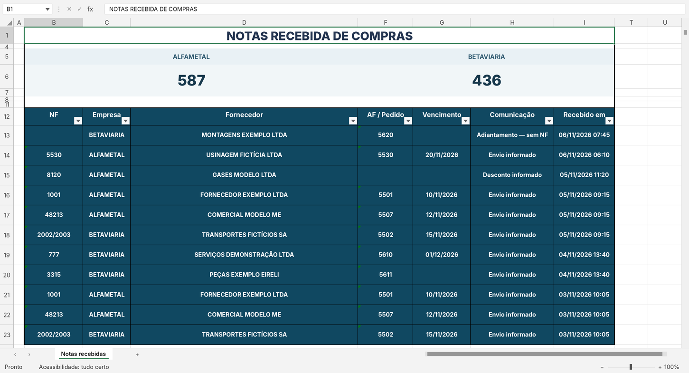

# E-mail + Nota = Excel — Office Script + Power Automate

[](https://github.com/Alantustoni/email-nota-excel/actions/workflows/tests.yml)

O setor de Compras avisa por e-mail quais notas fiscais chegaram. Este
projeto transforma esses e-mails numa planilha centralizada, sem digitação
e sem duplicar registros:

```
Outlook ──► Power Automate ──► Office Script ──► Excel (tbNotas · tbEmails · tbRevisao)
 e-mail       a cada e-mail      lê o HTML,        notas no topo, contadores
 de Compras   que chega          extrai as notas   por empresa, pendências
```

Está em uso num setor de contas a pagar real desde set/2026. Neste
repositório, empresas, fornecedores e e-mails são **fictícios**.



> **English summary** — An Excel Office Script, triggered by Power Automate
> for every incoming Outlook e-mail, that parses HTML tables in the body
> (nested tables, rowspan/colspan, label-only text) and logs each invoice
> into Excel tables. It is idempotent per message ID, flags possible
> duplicates without blocking them, never guesses missing fields, and
> neutralizes formula injection. 15 tests run in Node against a mocked
> workbook.

## O que ele faz

- **Lê o corpo HTML** do e-mail com um parser próprio. O Office Scripts não
  tem DOM, então o parser trata tabelas aninhadas e `rowspan`/`colspan`. Ele
  reconhece os cabeçalhos por sinônimos ("NF", "Nota fiscal", "Nº NF"...;
  "Vencimento", "Vcto"...). Também entende e-mails sem tabela, com rótulos
  no texto (`NF: 123`).
- **Não adivinha.** Campo ausente fica em branco, e a linha vai junto com
  uma pendência na aba Revisao. Se a NF do assunto diferir da NF da tabela,
  a NF fica em branco até alguém conferir.
- **Idempotente.** O mesmo e-mail (pelo ID da mensagem) nunca entra duas
  vezes, então "Reenviar" no Power Automate é seguro.
- **Alerta de duplicidade sem bloquear.** Outro e-mail com os mesmos dados
  é registrado, marcado como "Possível duplicidade - conferir" e destacado
  em amarelo.
- **ENC/RES.** Se a mesma relação de notas aparece repetida no histórico da
  conversa, ela conta uma vez. Se aparecem relações diferentes, nenhuma é
  escolhida em silêncio: vira pendência.
- **Segurança.** Texto que começa com `=`, `+`, `-` ou `@` é gravado como
  texto, para não virar fórmula no Excel. O link do e-mail só é aceito se
  for do Outlook.

## Estrutura

```
src/registrar_email_compras.ts   o Office Script (cole no Excel para a Web)
modelo/Controle_Notas_modelo.xlsx   planilha vazia, pronta para usar
modelo/Controle_Notas_exemplo.xlsx  a mesma planilha, preenchida pelo script com e-mails fictícios
docs/power-automate.md           passo a passo do fluxo e mapeamento dos parâmetros
tests/                           testes em Node com uma planilha simulada
tools/                           geram o exemplo (Node) e os .xlsx (Python + openpyxl)
```

## Configuração

No topo de `src/registrar_email_compras.ts`:

```ts
const EMPRESAS: string[] = ["ALFAMETAL", "BETAVIARIA"];  // empresas destinatárias
const CONTADORES_PAINEL: string[] = ["B6", "F6"];        // contador de cada empresa no painel
const FUSO_HORAS = -3;                                   // Brasília
```

O passo a passo do fluxo está em [docs/power-automate.md](docs/power-automate.md).

## Testes

O Office Scripts não roda fora do Excel, então `tests/carregar.mjs` carrega
o `.ts` direto no Node e simula a parte da API do Excel que o script usa
(tabelas, linhas e células). Assim os testes cobrem o parser e também o
fluxo completo do `main`.

```bash
npm test        # Node 22.18 ou mais novo (roda TypeScript sem compilar)
```

São 15 testes, entre eles:
- leitura de tabela;
- empresa citada fora da tabela;
- campo ausente;
- conflito entre assunto e corpo;
- `rowspan`/`colspan` e HTML quebrado;
- ENC/RES;
- números e datas no formato brasileiro;
- injeção de fórmula e link suspeito;
- registro completo, reprocessamento e duplicidade.

Para gerar de novo as planilhas de exemplo:

```bash
node tools/gerar_exemplo.mjs
python tools/gerar_planilhas.py
```

## Limites conhecidos

- Não lê anexos (PDF, XML, imagens), só o corpo do e-mail.
- Registra o que o e-mail **informa**. Não confirma que a nota existe, que
  foi lançada ou paga.
- O gatilho do Outlook no Power Automate pode levar alguns minutos para
  disparar.

## Como foi feito

O fluxo e o script foram desenvolvidos com ajuda do ChatGPT e do OpenAI
Codex, a partir de e-mails reais do setor, e testados em produção com
e-mails de verdade antes desta versão pública.

## Licença

MIT — veja [LICENSE](LICENSE).
